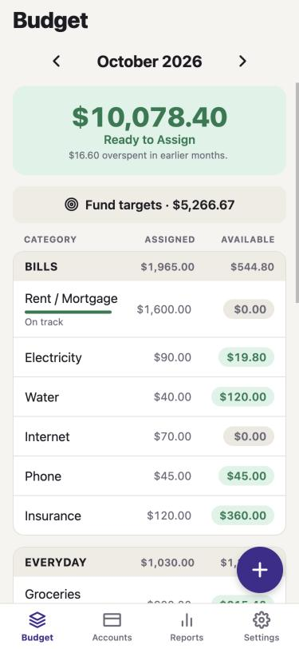
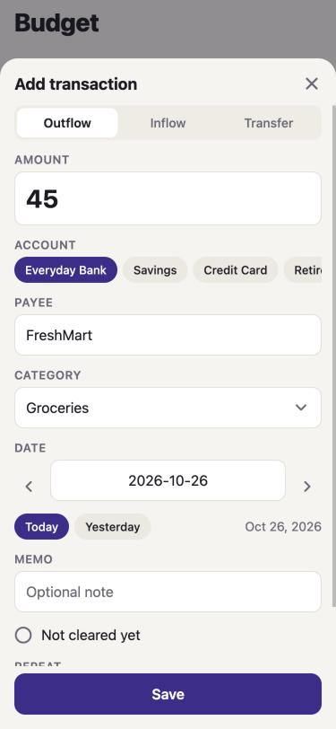
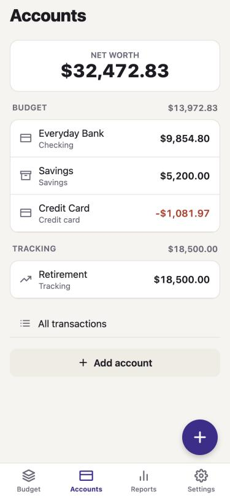
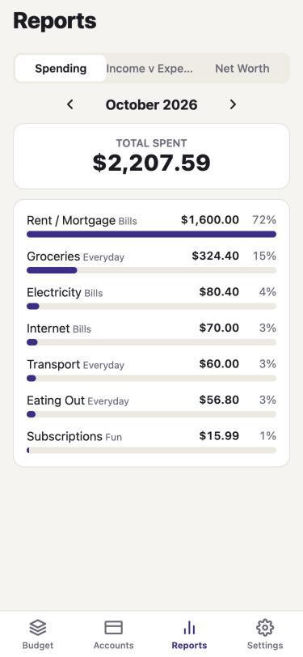
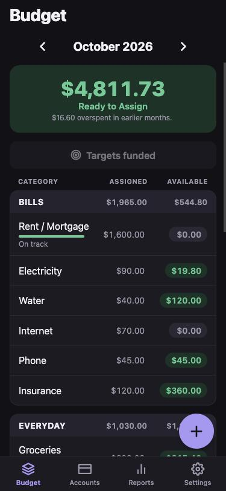

# Allot

**Give every dollar a job.** Allot is a free, open-source zero-based budgeting app for iOS and Android. Everything stays on your phone: no account, no servers, no tracking.

<p>
  
  
  
  
  
</p>

## How it works

1. **Add the money you have.** Account balances and income land in *Ready to Assign*.
2. **Assign it to categories** until Ready to Assign is zero. Every dollar now has a job.
3. **Record spending.** Each transaction takes money from its category's *Available* balance.
4. **Adjust as life happens.** Overspent on groceries? Move money from another category.
5. **Leftovers roll over.** Unspent money carries into next month. Overspending is taken from next month's Ready to Assign.

## Features

- **Monthly budget:** Ready to Assign, assigned / activity / available per category, month-by-month navigation, copy last month's plan
- **Targets:** monthly amount, target balance, or save-by-date, with progress bars and a one-tap "Fund targets"
- **Move money** between categories, cover overspending in one tap
- **Accounts:** checking, savings, cash, credit cards, and off-budget tracking accounts (investments, loans)
- **Transactions:** inflows, outflows, transfers, payee autocomplete that remembers the last category, memos, cleared status
- **Repeating transactions:** weekly, every two weeks, monthly or yearly, entered automatically when due
- **Reconcile** against your bank balance, with an automatic adjustment if needed
- **Reports:** spending by category, income vs. expenses (6 months), net worth (12 months)
- **CSV import & export:** paste your bank's CSV export straight in
- Light and dark mode, 12 currencies, demo budget to explore

## Install

Grab the latest build from [Releases](../../releases/latest).

- **Android:** download `Allot-android.apk` and open it on your phone (allow "install unknown apps" when asked).
- **iOS Simulator:** download `Allot-ios-simulator.zip`, unzip, and drag `Allot.app` onto a running simulator.
- **iPhone:** download `Allot-unsigned.ipa` and sideload it with [AltStore](https://altstore.io) or [Sideloadly](https://sideloadly.io), which sign it with your own Apple ID. (Apple won't install an unsigned app directly. Free Apple IDs need re-signing every 7 days.)

## Develop

Requires Node 20+.

```bash
npm install
npm run web        # try it in the browser
npm run ios        # iOS simulator (needs Xcode)
npm run android    # Android emulator (needs Android Studio)
npm test           # budget engine tests
npm run typecheck
```

Built with Expo (React Native) and TypeScript. The budgeting logic lives in `src/lib/` as plain functions with tests. The screens are in `src/screens/`.

Pushing a `v*` tag runs `.github/workflows/release.yml`, which builds the Android APK and the iOS Simulator app and attaches them to a GitHub release.

## License

MIT. Allot is an independent project and is not affiliated with or endorsed by any other budgeting app or company.
